 

### AI-focused Master of IT student in Melbourne

Building thoughtful software, learning intelligent systems, and turning ideas into useful things.

---

### About me

Hi, I'm **Rita** — a Master of Information Technology student specialising in **Artificial Intelligence** at the University of Melbourne.

- 🎓 Master of Information Technology (AI), **The University of Melbourne**, 2026–2027
- 🎓 B.E. in Computer Science and Technology, **Hangzhou Dianzi University**, 2021–2025
- 🌏 Based in Melbourne, Australia

---

### Tech stack

  
  
  
  
  
  
  
  
  
  
  
  
  

### Let's connect

<!-- Add only the contact methods you actively check. -->

<!--  -->
<!--  -->

Thanks for stopping by ✨

